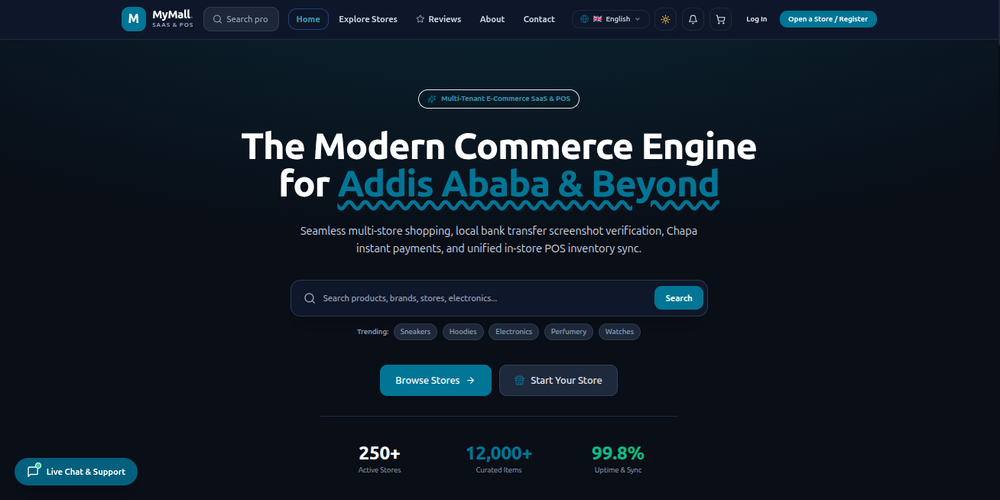
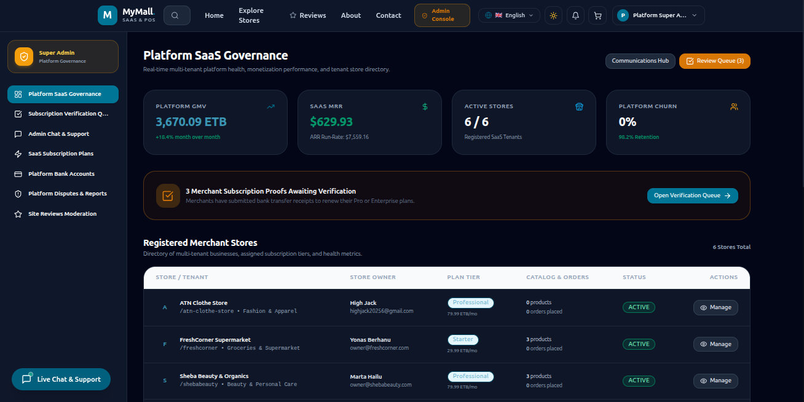
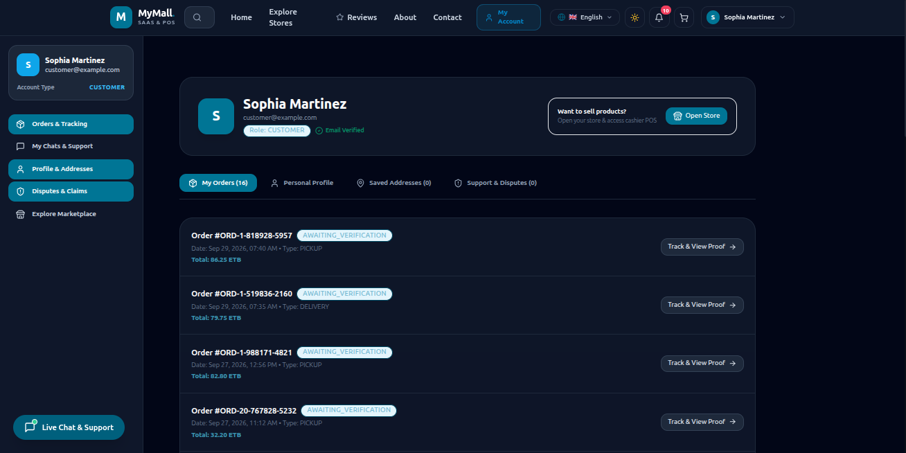
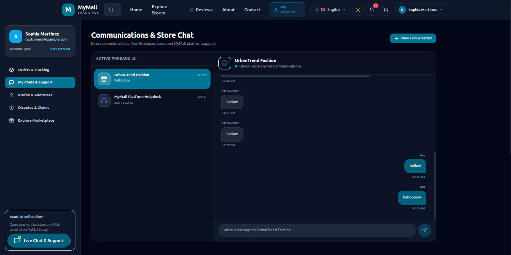
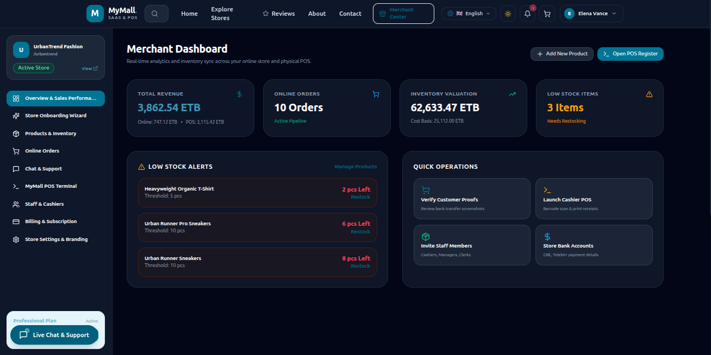
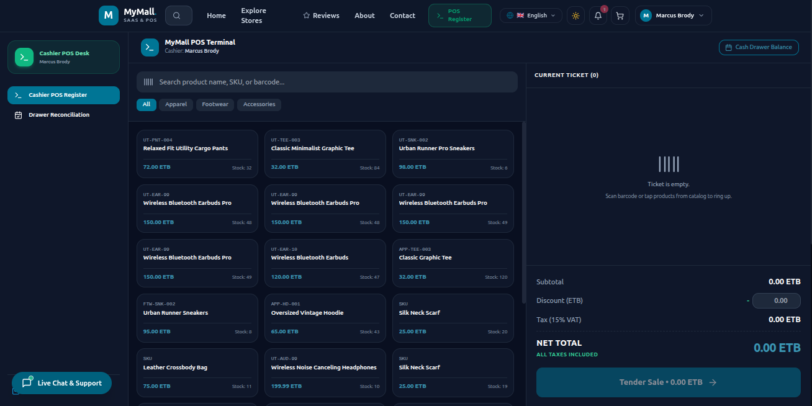

# 🛍️ MyMall Frontend — Multi-Tenant E-Commerce SaaS & POS Platform

[](https://nextjs.org/)
[](https://www.typescriptlang.org/)
[](https://tailwindcss.com/)
[](https://socket.io/)
[](https://www.mapbox.com/)

A modern, high-performance, enterprise-grade multi-tenant e-commerce marketplace, SaaS platform, and Point-of-Sale (POS) frontend built with **Next.js 14 (App Router)**, **TypeScript**, and **Tailwind CSS**.

Designed specifically for multi-store retail ecosystems, subscription SaaS billing, cashier POS registers with 80mm thermal receipt printing, interactive Mapbox delivery geolocation, and localized Ethiopian payment methods (Telebirr, CBE Birr, Chapa, and Bank Screenshot proof).

## 📸 Screenshots

### 🏨 Public Landing Page


### 🖥️ Admin Dashboard


### 🖥️ Customer Dashboard


### 🛎️ Chatting Page


### 📱 Store Owner Dashboard


### 📱 POS Page

---


## 🔗 Backend Engine Repository

This frontend client connects to a dedicated, high-performance backend API engine:

👉 **Backend Repository:** [`mymall_backend`](https://github.com/DrLeroK/mymall_backend)
- **Stack:** Node.js, Express, TypeScript, PostgreSQL, Prisma ORM, Socket.io, Multer, JWT.
- **Port:** `http://localhost:5001` (REST API: `/api/v1`, Socket.io: `ws://localhost:5001`)

*Ensure the backend is running before launching the frontend to enable authentication, real-time WebSockets, product management, and order processing.*

---

## ✨ Key Features

### 🏪 1. Multi-Tenant Storefronts & Marketplace
- **Dedicated Store Routes**: Direct slug-based storefront routing (`/store/[slug]`) with custom branding, banner hero images, store policies, and operating hours.
- **Comprehensive Product Catalogs**: Grid/list browsing, real-time inventory stock indicators, discounted pricing badges, category filtering, and product reviews.
- **Dynamic Store Switching**: Customers can explore diverse merchants across the marketplace or purchase directly from individual vendor storefronts.

### 🗺️ 2. Mapbox Delivery Location Picker (Light & Dark Mode)
- **High-Fidelity Mapbox GL JS**: Uses custom Mapbox vector tiles (`streets-v12` for light mode, `dark-v11` for dark mode).
- **Interactive Pin Placement**: Click anywhere directly on the map or drag the custom `"Delivery Spot"` marker pin to set doorstep coordinates.
- **Reverse Geocoding**: Automatically fetches and populates real-world Ethiopian street names and neighborhoods using the Mapbox Geocoding API.
- **Smart Ethiopian Landmarks**: Quick-fly chips for popular Addis Ababa and regional hubs (Bole, Kazanchis, Mexico, Piassa, Megenagna, Gerji, Sarbet, Summit, Ayat, Lebu, Gotera, Adama, Hawassa).
- **GPS Auto-Locate**: Built-in Mapbox `GeolocateControl` to automatically center on the user's current GPS location.

### 💳 3. Localized Ethiopian Checkout & Payments
- **Chapa Payment Gateway**: Seamless checkout with Telebirr, CBE Birr, Awash, and debit/credit cards.
- **Dynamic Store Key Detection**: Automatically detects whether the merchant has configured their Chapa API keys. If keys are missing, Chapa payment is gracefully hidden or disabled with a helpful notification.
- **Bank Transfer with Screenshot Proof**: Direct transfer to Commercial Bank of Ethiopia (CBE), Telebirr, or Awash Bank with client-side screenshot proof upload (`image/jpeg`, `image/png`, `application/pdf`).
- **Flexible Fulfillment**: Choice between Doorstep Delivery (with Mapbox GPS coordinates) and In-Store Pickup.

### 👥 4. Store Owner & Staff Management Center (`/merchant/staff`)
- **Granular Role Controls**: Change staff roles on the fly between `CASHIER`, `MANAGER`, and `INVENTORY_CLERK`.
- **Instant Deactivation**: Store owners can deactivate and reactivate staff members with a single click, instantly blocking login access (HTTP 403).
- **Staff Deletion & Invitation Management**: Revoke pending invites or permanently remove former staff from the merchant team.

### 📠 5. Point of Sale (POS) Terminal & Cashier Register (`/pos`)
- **Cashier Register UI**: High-speed touch-friendly interface for in-store sales, barcode scanning, manual search, and rapid line-item discounts.
- **80mm Thermal Receipt Printing**: Built-in standard POS thermal receipt formatting ready for ESC/POS or browser window printing.
- **Cash Reconciliation (`/pos/reconciliation`)**: Shift opening/closing balance tracking, cash-in/cash-out tracking, and discrepancy reporting.

### 🔔 6. Real-Time Socket.io Notifications & Live Chat
- **Role-Gated Order Alerts**: New order alerts are strictly delivered to the respective Store Owner and staff members — never polluting platform superadmins.
- **Persistent "Seen" Status**: Alerts marked as seen are updated in the database (`PATCH /notifications/read-all`) and stay cleared across page reloads.
- **Live Customer-Merchant Chat**: Slide-over chat drawer (`LiveChatDrawer`) with instant typing indicators, unread badges, and conversation history.

### 📱 7. Responsive Navigation & Mobile Drawer
- **Clean Responsive Navbar**: Small-screen hamburger navigation drawer consolidating:
  - Language Selector (English, Amharic, Afaan Oromoo)
  - Dark / Light Mode theme toggle
  - Real-time Notifications Bell with counter
  - Shopping Cart summary
- **Zero Layout Shift**: Fluid scaling across desktop, tablet, and mobile displays.

### 🌍 8. Multilingual Internationalization (i18n)
- Runtime instant language switching with zero page reloads:
  - 🇬🇧 **English (`en`)**
  - 🇪🇹 **Amharic (`am` / አማርኛ)**
  - 🇪🇹 **Afaan Oromoo (`om`)**

### 🛡️ 9. Super Admin Governance (`/admin`)
- **Verification Center**: Review and approve customer bank transfer receipts before dispatching orders.
- **Store Approval & Monitoring**: Onboard, verify, freeze, or monitor active vendor storefronts.
- **Dispute Resolution**: Dedicated dispute mediation portal for order complaints.
- **Platform Bank Accounts**: Manage centralized corporate bank accounts displayed during checkout.

---

## 🛠️ Tech Stack & Libraries

| Technology | Purpose |
| :--- | :--- |
| **Next.js 14 (App Router)** | React full-stack framework with Server & Client components |
| **React 18** | UI component architecture and state hooks |
| **TypeScript 5.6** | Static type checking and full end-to-end type safety |
| **Tailwind CSS 3.4** | Utility-first CSS styling with custom theme tokens |
| **Mapbox GL JS** | Interactive vector mapping, geocoding, and GPS picking |
| **Socket.io Client** | Real-time WebSocket connection for chat and notifications |
| **Lucide React** | Lightweight, accessible UI icon system |
| **Next Themes** | Robust dark and light theme switching with localStorage sync |
| **Tailwind Merge & Clsx** | Conflict-free conditional CSS class management |

---

## 📁 Project Directory Structure

```text
mymall/
├── .env.example              # Environment variables template
├── .gitignore                # Git ignore configuration
├── next.config.mjs           # Next.js configuration & security response headers
├── package.json              # Project dependencies and run scripts
├── postcss.config.mjs        # PostCSS configuration for Tailwind CSS v3
├── tailwind.config.ts        # Tailwind theme tokens, brand colors, dark mode
├── tsconfig.json             # TypeScript compiler settings
│
├── public/                   # Static assets, logos, and placeholders
│
└── src/
    ├── app/                  # Next.js 14 App Router pages & routes
    │   ├── layout.tsx        # Root HTML layout with providers (Theme, Auth, Socket, i18n)
    │   ├── globals.css       # Tailwind directives, print receipt styles, dark theme
    │   ├── page.tsx          # Main marketplace landing & store discovery
    │   │
    │   ├── about/            # About page
    │   ├── contact/          # Contact support page
    │   ├── explore/          # Marketplace explore & vendor directory
    │   ├── reviews/          # Platform feedback & testimonials
    │   ├── cart/             # Shopping cart, checkout, payment, & Mapbox picker
    │   ├── orders/[id]/      # Public/Customer order receipt & tracking
    │   ├── login/            # Authentication: User sign-in
    │   ├── register/         # Authentication: Customer/Merchant sign-up
    │   ├── forgot-password/  # Password reset flow
    │   │
    │   ├── store/[slug]/     # Multi-tenant storefront & vendor catalog
    │   │   └── product/[productId]/ # Product detail page & customer reviews
    │   │
    │   ├── customer/         # Customer account portal
    │   │   └── chat/         # Customer direct chat with merchants
    │   │
    │   ├── merchant/         # Merchant / Store Owner Control Center
    │   │   ├── billing/      # Subscription SaaS plan & upgrade portal
    │   │   ├── chat/         # Store live messaging center
    │   │   ├── onboard/      # Merchant store onboarding wizard
    │   │   ├── orders/       # Order fulfillment and status management
    │   │   ├── products/     # Product catalog CRUD, variant & stock management
    │   │   ├── settings/     # Store profile, branding, and Chapa API keys
    │   │   └── staff/        # Staff & cashiers management (roles, toggle, delete)
    │   │
    │   ├── pos/              # Point of Sale (POS) Cashier Register
    │   │   └── reconciliation/ # Shift opening/closing cash float reconciliation
    │   │
    │   ├── staff/
    │   │   └── accept/       # Staff invitation acceptance verification
    │   │
    │   └── admin/            # Super Admin Platform Management
    │       ├── bank-accounts/# Central platform bank accounts
    │       ├── chat/         # Superadmin customer/store support chat
    │       ├── disputes/     # Dispute resolution management
    │       ├── plans/        # SaaS subscription tier management
    │       ├── reviews/      # Product review moderation
    │       ├── stores/[id]/  # Individual store audit and control
    │       └── verifications/# Bank transfer screenshot approval queue
    │
    ├── components/           # Reusable UI component library
    │   ├── checkout/         # MapPickerModal.tsx (Mapbox location picker)
    │   ├── common/           # Navbar, Footer, NotificationBell, ThemeToggle, i18n
    │   ├── chat/             # LiveChatDrawer.tsx (Socket.io messaging)
    │   ├── storefront/       # ProductCard.tsx, store headers
    │   └── ui/               # Button, Modal, Card, Input, Badge, Tabs
    │
    ├── context/              # React Context Providers
    │   ├── AuthContext.tsx   # User authentication, token decoding, role state
    │   ├── CartContext.tsx   # Shopping cart persistence, items, discounts
    │   ├── I18nContext.tsx   # Multi-language translation state
    │   └── SocketContext.tsx # Real-time Socket.io rooms, alerts, chat events
    │
    ├── i18n/                 # Localization dictionaries
    │   └── translations.ts   # English, Amharic, and Afaan Oromoo translations
    │
    ├── lib/                  # Shared utilities & services
    │   ├── api.ts            # Centralized API service with token handling
    │   ├── security.ts       # Defensive storage, JWT validation, XSS sanitizers
    │   └── utils.ts          # Tailwind cn merge, currency formatting
    │
    └── types/                # Global TypeScript declarations & models
        └── index.ts          # User, Store, Order, Product, Alert definitions
```

---

## 🚀 Getting Started & How to Run

### Prerequisites
- **Node.js**: `v18.17+` or `v20.x` (Recommended: `v20 LTS`)
- **npm** (`v9+`) or **yarn** / **pnpm**
- **Running Backend**: The [`mymall_backend`](https://github.com/DrLeroK/mymall_backend) must be running on port `5001`.

---

### Step 1: Clone the Repository
```bash
git clone https://github.com/DrLeroK/mymall.git
cd mymall
```

### Step 2: Install Dependencies
```bash
npm install
```

### Step 3: Configure Environment Variables
Create a `.env` file in the root directory (or copy from `.env.example`):
```bash
cp .env.example .env
```

Ensure your `.env` configuration contains:
```env
# Base URL of Express backend API
NEXT_PUBLIC_API_URL=http://localhost:5001/api/v1

# Real-Time Socket.io Server URL
NEXT_PUBLIC_SOCKET_URL=http://localhost:5001

# Public uploads static assets URL
NEXT_PUBLIC_UPLOADS_URL=http://localhost:5001/uploads

# Default store slug for direct storefront routing
NEXT_PUBLIC_DEFAULT_STORE_SLUG=urbantrend

# Mapbox Access Token for Delivery Location Picker
NEXT_PUBLIC_MAPBOX_TOKEN=your_mapbox_public_token_here

# Chapa Payment Gateway Public Key (Test or Live)
NEXT_PUBLIC_CHAPA_KEY=CHAPUBK_TEST-your_chapa_public_key_here

# Node environment mode
NODE_ENV=development
```

> **Note on Mapbox:** If you don't have a Mapbox token, you can get one for free at [mapbox.com](https://www.mapbox.com/).

### Step 4: Run the Development Server
```bash
npm run dev
```
Open your browser and navigate to:
```text
http://localhost:3000
```

### Step 5: Build for Production
To test the optimized production build:
```bash
# Compile and build production bundles
npm run build

# Start the production server on port 3000
npm run start
```

### Step 6: Run Code Quality Checks
To verify 100% type safety and zero lint errors:
```bash
npm run lint
```

---

## 🔒 Security Best Practices Implemented

1. **HTTP Security Headers (`next.config.mjs`)**:
   - `X-Frame-Options: SAMEORIGIN` (prevents clickjacking attacks).
   - `X-Content-Type-Options: nosniff` (prevents MIME confusion).
   - `Strict-Transport-Security: max-age=63072000; includeSubDomains; preload` (enforces HTTPS).
   - `Referrer-Policy: strict-origin-when-cross-origin` (prevents leaking sensitive query params).
   - `Permissions-Policy: camera=(), microphone=(), geolocation=(self)`.
   - `poweredByHeader: false` (removes Next.js signature).
2. **Defensive Storage & Token Validation (`security.ts`)**:
   - JWT tokens are validated for a valid 3-part Base64 structure before decoding or persisting.
   - In-memory fallback if `localStorage` is disabled or blocked.
   - Silent refresh checks before requests to prevent sudden session expirations.
3. **Client-Side File Inspection**:
   - Restricts uploads to valid images and PDFs with a strict 5MB size limit.
   - Strips directory traversal characters (`../`) from filenames.
4. **XSS Sanitization & Data Masking**:
   - Sanitizes user input before rendering.
   - Masks sensitive account numbers and personal identifiers on public views.

---

## 🤝 Related Repositories

| Repository | Description | Link |
| :--- | :--- | :--- |
| **`mymall`** *(This Repo)* | Next.js 14 Multi-Tenant Frontend & POS | *Current Repository* |
| **`mymall_backend`** | Express, Prisma, PostgreSQL & Socket.io Engine | [mymall_backend](https://github.com/your-username/mymall_backend) |

---

## 📄 License

This project is licensed under the **MIT License**. Feel free to use, customize, and extend it for your own e-commerce and POS deployments.
